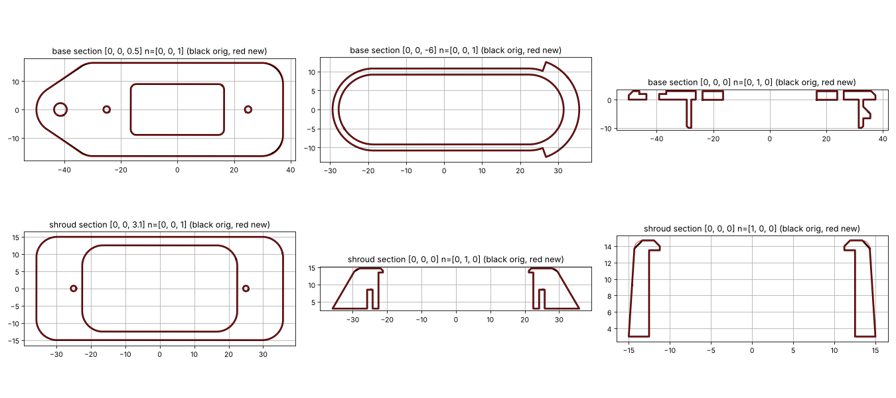

# Parametric TCU bezel

[`tcu_bezel.py`](tcu_bezel.py) rebuilds the two printed parts in
[`../3d-print/`](../3d-print/) as a parametric **CadQuery** model. All dimensions were measured
from the original STL files. The rebuilt parts match them to within **0.6 % by volume**, with
identical bounding boxes. The overlay below compares sections of the original (black) and the
rebuilt part (red).



## Files

| File | Use |
|---|---|
| `tcu_bezel.py` | The model: every dimension is a named parameter in `P` at the top |
| `out/base.step`, `out/shroud.step` | Solids for any CAD tool (Fusion, Onshape, FreeCAD, SolidWorks …) |
| `out/tcu_bezel_assembly.step` | Both parts in position |
| `out/base.stl`, `out/shroud.stl` | Ready to slice |

## Regenerate

```sh
pip install cadquery trimesh manifold3d   # trimesh/manifold3d only for --compare
python3 hardware/cad/tcu_bezel.py --compare
```

## What the parameters describe

| Group | Key parameters | Original value |
|---|---|---|
| Base flange | `flange_t`, `flange_half_len`, `flange_half_w`, `flange_corner_r`, `flange_chamfer` | 3, ±30.6, 16.5, R6.75, 1.5 × 45° |
| Mounting tab | `nose_x`, `nose_r`, `mount_hole_d`, `cbore_d`, `cbore_depth` | −41.35, R8.5, Ø4.5, Ø9.5 × 1 |
| Cable window | `window_l` × `window_w`, `window_r` | 33 × 18, R2 |
| Shroud screws | `screw_x`, `screw_clear_d` (base), `pilot_d`, `pilot_depth` (shroud) | ±25, Ø2.3, Ø1.6 × 5.5 (M2 self-tapping) |
| Skirt into the frame | `skirt_l` × `skirt_w` stadium, `skirt_x`, `skirt_wall`, `skirt_depth` | 62.4 × 21.6, +1.85, 1.6, 10 |
| Snap barb (+X end) | `barb_out`, `barb_bottom`, `barb_flat`, `barb_ramp`, `barb_half_angle` | 2.5, Z −6.5, 1.5, 2.5 (45°), ±70° |
| Shroud outer | `shroud_bot_*` → `shroud_top_*` (ruled loft), `shroud_h`, `shroud_top_fillet` | 71.7 × 30 R6 → 58 × 28.5 R8.5, 11.7, R1 |
| Display pocket | `pocket_l` × `pocket_w`, `pocket_r` | 45 × 25.04, R6 |
| Retaining lip | `lip_l` × `lip_w`, `lip_r`, `lip_t`, `lip_chamfer` | 42.4 × 22.46, R4.7, 1.2, 0.7 |

The coordinate system is the same as the original STLs: Z up, the flange's underside at Z = 0,
+X at the barb end.

## Typical edits

* **Different frame opening (e.g. Kenevo):** measure the TCU cut-out, then set `skirt_l`, `skirt_w`
  and `skirt_x`. Adjust `barb_bottom` to the frame wall thickness under the flange.
* **Tighter display fit:** change `pocket_l`/`pocket_w` in steps of 0.1–0.2 mm for your printer.
* **Foam pad under the board** (recommended for the IMU features): reduce `lip_t`, or print the
  shroud 1 mm taller via `shroud_h` and pad the gap.
* **Weather seal:** add a groove in the flange underside. Use the `circle_hull_wire()` helper
  offset inwards.

Small differences to the originals: the flange's straight flanks are pure tangents between the
tab and corner radii, and the shroud's side taper is linear. Both are within 0.25 mm of the
original surfaces.
